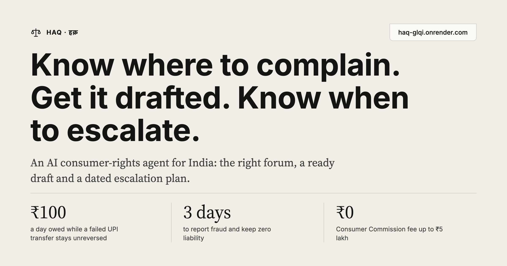
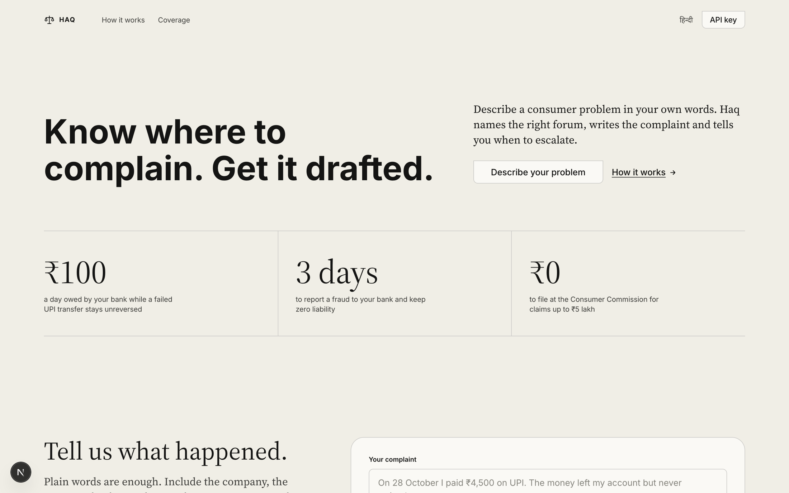
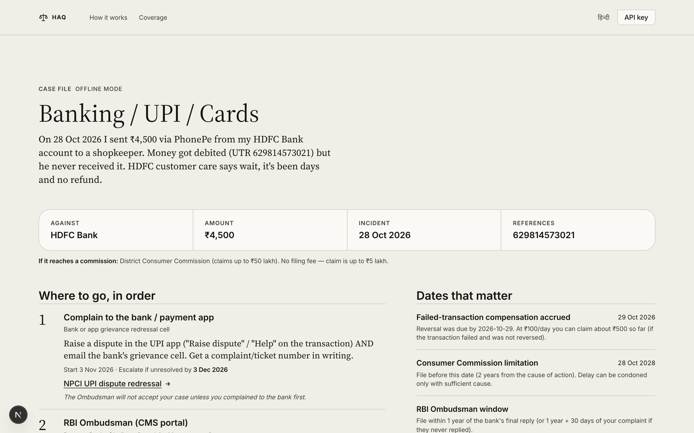
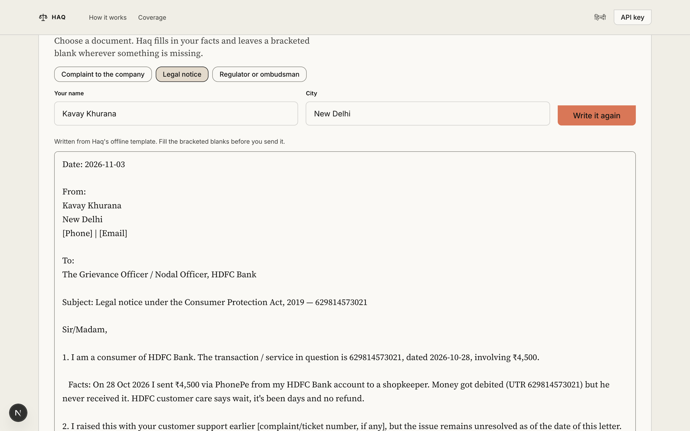
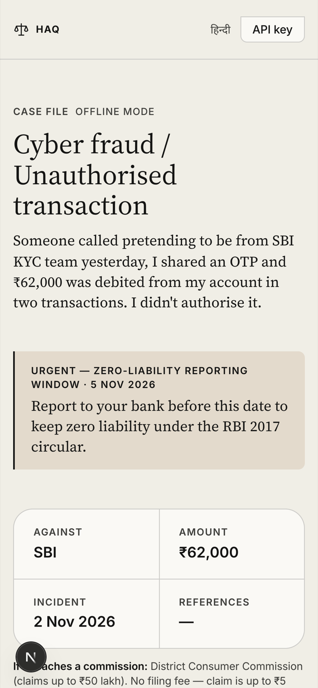
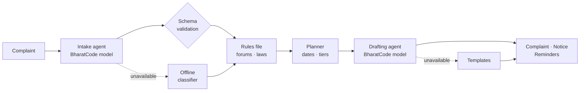

<a href="https://haq-glqi.onrender.com"></a>

<div align="center">

**An AI consumer-rights agent for India, built on the BharatCode model API.**

[](https://haq-glqi.onrender.com)
[](https://github.com/Kavaykhurana/bharatcode/actions/workflows/ci.yml)
[](https://nextjs.org)
[](tsconfig.json)
[](LICENSE)

[**Try it live**](https://haq-glqi.onrender.com) · [How it works](#how-it-works) · [API reference](#api-reference) · [Run locally](#getting-started)

</div>

<br />



## Contents

- [About](#about)
- [Features](#features)
- [Screenshots](#screenshots)
- [How it works](#how-it-works)
- [Design principles](#design-principles)
- [Coverage](#coverage)
- [Architecture](#architecture)
- [API reference](#api-reference)
- [Configuration](#configuration)
- [Tech stack](#tech-stack)
- [Getting started](#getting-started)
- [Testing](#testing)
- [Design system](#design-system)
- [Deployment](#deployment)
- [Known limitations and roadmap](#known-limitations-and-roadmap)
- [Contributing](#contributing)
- [Team](#team)
- [Disclaimer](#disclaimer)
- [License](#license)

## About

A UPI transfer leaves your account and never arrives. A phone is dead on delivery and the return is refused. A flight is cancelled and the refund stalls.

Indian law already protects people in these situations. The RBI owes you **₹100 a day** while a failed transfer stays unreversed. Fraud reported within **three working days** carries **zero liability**. Consumer Commission filing is **free** for claims up to ₹5 lakh. Most people never use these protections because they don't know where to complain, what to write, or when a deadline closes.

**Haq** (हक़, "rightful claim") answers all three. Describe the problem in English, Hindi or Hinglish. Haq identifies the right forum, lays out the escalation path with dates, cites the rules that apply, and drafts the complaint.

## Features

| Capability | What it does |
|---|---|
| **Understands plain language** | Extracts the company, amount, date and any UTR, order ID, PNR or policy number from free text in English, Hindi or Hinglish. |
| **Routes to the right forum** | Builds the escalation ladder the rules require, for example bank, then RBI Ombudsman, then Consumer Commission, with portals and helplines. |
| **Computes deadlines** | Escalation dates, the zero-liability window in working days, compensation already accrued, the two-year limitation period, and the Commission tier for the claim value. |
| **Cites only curated law** | Provisions come from a reviewed rules file, not from the model, so helplines and sections cannot be invented. |
| **Drafts the document** | A complaint to the company, a legal notice, or text for a regulator's portal, streamed live in English or Hindi. |
| **Keeps you on schedule** | Calendar reminders (`.ics`) for every escalation date, plus WhatsApp share, copy, download and print-to-PDF. |
| **Degrades gracefully** | If the model is unavailable, a rule-based classifier and templates take over, so the user still gets a complete plan. |

## Screenshots



<table>
  <tr>
    <td width="64%" valign="top"></td>
    <td width="36%" valign="top"></td>
  </tr>
  <tr>
    <td align="center"><sub>Drafting a legal notice</sub></td>
    <td align="center"><sub>Cyber-fraud case on mobile</sub></td>
  </tr>
</table>

## How it works

The model reads and writes. **It never decides where you go.** Forums, deadlines and statutes come from a human-reviewed rules file, and the model's output is validated before anything is shown.



1. **Intake.** The model returns a JSON object (category, parties, amount, date, reference IDs, missing information). It is validated with zod and repaired field by field against a deterministic extractor if it drifts.
2. **Routing.** The validated category selects a ladder, provisions, evidence checklist and tips from `lib/knowledge.ts`.
3. **Planning.** Plain date arithmetic lays the ladder onto the calendar and computes deadlines. No model is involved.
4. **Drafting.** A second model call streams the document, constrained to cite only the provisions in the rules file for that category. Unknown facts become bracketed blanks.

## Design principles

- **The model never decides routing.** It classifies and extracts facts. Every forum, helpline, statute and waiting period shown to the user is read from `lib/knowledge.ts`.
- **Model output is schema-validated.** Intake JSON is parsed with zod, coerced where safe (for example `"₹4,500"` to a number), repaired per field, and sanitised (an incident date in the future is dropped).
- **Offline fallback everywhere.** With no key, an invalid key, a timeout or an unparseable response, Haq falls back to a rule-based classifier and deterministic templates. The plan and the draft are still complete.
- **No invented helplines or sections.** The drafting prompt allows only the provisions listed for the case's category, and instructs the model to leave a bracketed blank instead of inventing a fact. Template drafts do the same, and a test covers it.
- **Dates are arithmetic, not generation.** Deadlines are computed in UTC from the client's local date, so results are reproducible and testable.
- **Dependency-light.** The model client is plain `fetch` with timeouts and one retry; the only runtime dependencies are Next.js, React and zod.

## Coverage

| Problem | First stop | Escalation path | Key provision |
|---|---|---|---|
| Banking, UPI, cards | Bank or UPI app | RBI Ombudsman → Consumer Commission | RBI TAT circular 2019 |
| Cyber fraud | 1930 · cybercrime.gov.in | Bank → RBI Ombudsman → Consumer Commission | RBI liability circular 2017 |
| E-commerce | Platform Grievance Officer | NCH 1915 → Legal notice → e-Daakhil | E-Commerce Rules 2020 |
| Telecom, broadband, DTH | Complaint centre (198) | Appellate Authority → NCH → Consumer Commission | TRAI Regulations 2012 |
| Insurance | Insurer's Grievance Officer | Bima Bharosa → Insurance Ombudsman → Consumer Commission | Ombudsman Rules 2017 |
| Airlines | Airline nodal officer | AirSewa → Consumer Commission | DGCA CAR Sec. 3, Series M |
| Real estate | Builder (written demand) | State RERA → Consumer Commission | RERA 2016, Sec. 18 |
| Other goods and services | Company grievance cell | NCH → Legal notice → e-Daakhil | Consumer Protection Act 2019 |

The eight category IDs are `banking_upi`, `cyber_fraud`, `ecommerce`, `telecom`, `insurance`, `airline`, `real_estate` and `general_consumer`.

## Architecture

```
.
├── app/
│   ├── layout.tsx            Root layout, metadata, font variables
│   ├── page.tsx              Renders the single-page client app
│   ├── fonts.ts              next/font setup (Source Serif 4, Inter, Noto Devanagari)
│   ├── globals.css           Design tokens and component styles
│   └── api/
│       ├── analyze/route.ts  POST: intake + plan, streamed as NDJSON
│       ├── draft/route.ts    POST: document draft, streamed as plain text
│       └── health/route.ts   GET: liveness probe used by Render
├── components/
│   └── HaqApp.tsx            The whole UI: intake form, case file, drafting, settings
├── lib/
│   ├── types.ts              zod schemas and shared types (requests, intake, plan, events)
│   ├── knowledge.ts          Curated forums, ladders, laws, evidence lists, commission tiers
│   ├── planner.ts            Date maths: ladder scheduling, working days, deadlines
│   ├── agent.ts              Intake agent: model call, validation, repair, fallback
│   ├── prompts.ts            System and user prompts for intake and drafting
│   ├── bharatcode.ts         OpenAI-compatible model client (timeout, retry, SSE streaming)
│   ├── heuristics.ts         Offline rule-based classifier and fact extractor
│   ├── templates.ts          Offline document templates with bracketed blanks
│   ├── json.ts               JSON extraction from model output; streaming think-block filter
│   ├── ics.ts                iCalendar (.ics) export for escalation reminders
│   └── ratelimit.ts          In-memory fixed-window rate limiter
├── tests/
│   └── core.test.ts          Vitest suite (planner, knowledge, classifier, outputs)
├── docs/                     README images
├── .github/workflows/ci.yml  Typecheck, test, build
├── render.yaml               Render Blueprint
├── SUBMISSION.md             BharatCode Build League submission kit
└── BharatCode.txt            Build League project summary
```

## API reference

All endpoints are served by the Next.js App Router on the Node.js runtime. `POST` bodies are JSON. Invalid input returns `400` with `{ "error": string }`. Rate-limited requests return `429` with `{ "error": string }` and a `Retry-After` header (seconds).

### `POST /api/analyze`

Classifies a complaint and builds the case plan. The response is a stream of newline-delimited JSON (`application/x-ndjson`): one event per line, ending with either a `result` or an `error`.

**Request body**

| Field | Type | Required | Notes |
|---|---|---|---|
| `story` | string | yes | The complaint in free text. 20 to 4000 characters after trimming. |
| `language` | `"en"` \| `"hi"` | no | Defaults to `"en"`. |
| `today` | string | no | Client's local date, `YYYY-MM-DD`. Defaults to the server's UTC date. Used for all deadline maths. |

**Events**

| `type` | Fields | Meaning |
|---|---|---|
| `step` | `id`: `"classify"` \| `"route"` \| `"plan"`; `status`: `"running"` \| `"done"`; `detail?`: string | Progress. Each step emits `running`, then `done`. |
| `result` | `plan`: `CasePlan` | Final payload. Emitted once on success. |
| `error` | `message`: string | The stream failed. Emitted instead of `result`. |

**`CasePlan`**

| Field | Type | Notes |
|---|---|---|
| `intake` | `Intake` | Extracted facts, see below. |
| `category` | `{ id, label, labelHi, emoji }` | The matched category. |
| `laws` | `{ name, point }[]` | Provisions from the rules file. |
| `steps` | `PlannedStep[]` | Escalation ladder: `id`, `title`, `forum`, `how`, `links[]`, `phones?`, `waitDays`, `note?`, plus `order`, `startOn`, `escalateOn` (`null` on the last step). |
| `deadlines` | `{ label, date, urgent, detail }[]` | `date` is `null` when it cannot be computed (for example no incident date). |
| `evidence` | string[] | Evidence checklist. |
| `tips` | string[] | Category-specific tips. |
| `commission` | `{ level, feeNote }` \| `null` | Consumer Commission tier for the claim value. `null` for categories whose ladder has no Commission step. |
| `mode` | `"ai"` \| `"offline"` | Whether the model or the offline classifier produced the intake. |
| `generatedOn` | string | The `today` date used, `YYYY-MM-DD`. |

**`Intake`**

| Field | Type |
|---|---|
| `category` | one of the eight category IDs |
| `summary` | string, max 600 characters |
| `opposite_party` | string \| `null` |
| `amount_inr` | number \| `null` |
| `incident_date` | `YYYY-MM-DD` \| `null` |
| `already_complained` | boolean |
| `reference_ids` | string[], max 10 |
| `missing_info` | string[], max 8 |
| `confidence` | number, 0 to 1 |

```bash
curl -N -X POST https://haq-glqi.onrender.com/api/analyze \
  -H "Content-Type: application/json" \
  -d '{"story":"I sent 4500 rupees by UPI on 1 November and it was debited but never credited.","language":"en"}'
```

```jsonc
{"type":"step","id":"classify","status":"running","detail":"Reading your complaint with the BharatCode model"}
{"type":"step","id":"classify","status":"done","detail":"Identified: banking upi"}
{"type":"step","id":"route","status":"running","detail":"Matching the right forum and law"}
// ...
{"type":"result","plan":{ /* CasePlan */ }}
```

### `POST /api/draft`

Streams a document for a case. The response is `text/plain; charset=utf-8`; read it incrementally and append chunks as they arrive.

**Request body**

| Field | Type | Required | Notes |
|---|---|---|---|
| `intake` | `Intake` | yes | Taken from the `analyze` result. |
| `story` | string | yes | The original complaint text, 20 to 4000 characters. |
| `docType` | `"company_complaint"` \| `"legal_notice"` \| `"regulator_complaint"` | yes | Document to draft. |
| `language` | `"en"` \| `"hi"` | no | Defaults to `"en"`. Hindi output is in Devanagari. |
| `complainant` | `{ name?: string, city?: string }` | no | Max 100 characters each. Missing values become `[Your Name]` and `[City]` blanks. |
| `today` | string | no | `YYYY-MM-DD`. Defaults to the server's UTC date. |

**Response**

- `X-Haq-Mode: ai | offline` header. `offline` means no usable API key was resolved for this request, so the body is a template.
- With a key, the body is the model's text with any `<think>` reasoning removed.
- **Fallback marker.** If the model fails part-way, or returns fewer than 80 characters, the server appends the sentinel `\u0000HAQ_FALLBACK\u0000` followed by the full template draft. A client must discard everything received before the marker and use the text after it. The `X-Haq-Mode` header is sent before streaming begins, so it cannot reflect a mid-stream fallback; check for the marker.

```bash
curl -N -X POST https://haq-glqi.onrender.com/api/draft \
  -H "Content-Type: application/json" \
  -d '{"intake":{ /* Intake */ },"story":"...","docType":"legal_notice","language":"en","complainant":{"name":"A. Sharma","city":"Pune"}}'
```

### `GET /api/health`

Liveness probe (used as the Render health check). Not rate limited.

```json
{ "status": "ok", "mode": "ai", "time": "2026-11-03T09:30:00.000Z" }
```

`mode` is `"ai"` when the server has a usable `BHARATCODE_API_KEY`, otherwise `"offline"`. The key is never returned.

### Rate limiting

Each client IP gets `RATE_LIMIT_PER_MINUTE` requests per minute, counted separately for `/api/analyze` and `/api/draft`. The IP is read from `cf-connecting-ip`, then the first `x-forwarded-for` entry, then `x-real-ip`.

## Configuration

Copy `.env.example` to `.env.local`. Everything is optional; without a key Haq runs in offline mode.

| Variable | Default | Purpose |
|---|---|---|
| `BHARATCODE_API_KEY` | none | Server-side key for the BharatCode model API. Without a usable key (and no BYOK header) the app is offline. |
| `BHARATCODE_BASE_URL` | `https://bharatcode.ai/api/model/v1` | OpenAI-compatible base URL. `/chat/completions` is appended. |
| `BHARATCODE_MODEL` | `qwen-3.8-27b` | Model name sent with each request. |
| `RATE_LIMIT_PER_MINUTE` | `20` | Requests per minute per IP, per API route. |

**Bring your own key.** A request may carry an `x-bharatcode-key` header. When present and well-formed (8 to 256 printable ASCII characters), it takes precedence over `BHARATCODE_API_KEY`. The in-app "API key" setting sets this header and stores the key in the browser's `localStorage` only; the server does not persist it.

## Tech stack

| Layer | Technology |
|---|---|
| Framework | Next.js 15 (App Router), React 19, TypeScript (strict) |
| AI | BharatCode model API (OpenAI-compatible), dependency-free client with streaming |
| Validation | zod |
| Styling | Tailwind CSS (layout utilities) with CSS custom properties for the design tokens; Source Serif 4, Inter, Noto Serif Devanagari and Noto Sans Devanagari |
| Testing | Vitest, plus a GitHub Actions CI pipeline |
| Hosting | Render (Singapore), defined in [`render.yaml`](render.yaml) |

## Getting started

Requires Node.js 18.18 or later. CI runs on Node 20 and the Render service on Node 22.

```bash
git clone https://github.com/Kavaykhurana/bharatcode.git
cd bharatcode && npm install
cp .env.example .env.local   # add BHARATCODE_API_KEY to enable the AI agents
npm run dev                  # http://localhost:3000
```

| Script | Does |
|---|---|
| `npm run dev` | Start the dev server |
| `npm run build` | Production build |
| `npm start` | Serve the production build |
| `npm run typecheck` | `tsc --noEmit` |
| `npm test` | Run the Vitest suite |

Without an API key, Haq runs in offline mode: rule-based classification and template drafts.

## Testing

```bash
npm test
```

The suite in [`tests/core.test.ts`](tests/core.test.ts) has 28 tests and runs in well under a second, with no network access. It covers:

- **Knowledge base:** every category has a ladder, laws and a valid regulator step; claim values map to the correct Commission tier.
- **Planner:** escalation dates chain from the start date; working-day arithmetic skips weekends; the zero-liability window, accrued ₹100/day compensation and two-year limitation are computed correctly, including leap-day edge cases.
- **Offline classifier:** category detection, Indian-format amounts, dates (never in the future), and order, UTR and PNR extraction.
- **Model output handling:** JSON extraction from fenced or reasoning-prefixed output, and `<think>` filtering across stream chunk boundaries.
- **Outputs:** valid iCalendar files with lines folded on UTF-8 octets, and template drafts that contain the facts and never invent missing ones.

CI ([`.github/workflows/ci.yml`](.github/workflows/ci.yml)) runs `npm run typecheck`, `npm test` and `npm run build` on every pull request and on pushes to `main`.

## Design system

The interface follows a warm "parchment" editorial system: a research publication printed on paper rather than a screen.

- **Surfaces.** Ivory and oat tones in a tonal ladder (canvas, card, featured, grouped, inverse). Separation comes from 1px hairlines. There are no shadows or gradients.
- **Type.** Source Serif 4 carries prose and headings; Inter carries UI chrome (navigation, buttons, labels). Noto Serif Devanagari and Noto Sans Devanagari keep the same serif and sans split for Hindi.
- **One accent.** Clay (`#d97757`) marks the single primary action in a view. Everything else is neutral.
- **Shape.** Filled buttons are rounded on the bottom corners only; outlined buttons use 12px radii; cards use 24px radii; inputs use 8px.
- **Tokens.** Colours, type scale, spacing and radii are CSS custom properties in [`app/globals.css`](app/globals.css). [`tailwind.config.ts`](tailwind.config.ts) replaces Tailwind's default palette with the same values, so off-system colours cannot be used by accident.

## Deployment

Live on Render at **[haq-glqi.onrender.com](https://haq-glqi.onrender.com)**, auto-deployed from `main` via the [`render.yaml`](render.yaml) Blueprint (free plan, Singapore region, `/api/health` as the health check).

To deploy your own copy: create a Blueprint from this repository on Render and enter `BHARATCODE_API_KEY` when prompted (it is marked `sync: false` and never committed). The other variables in [Configuration](#configuration) are pre-set in the Blueprint.

## Known limitations and roadmap

- **The rate limiter is per instance.** It is an in-memory fixed window, so limits reset on restart and are not shared across instances. Multi-instance deployments need a shared store (for example Redis).
- **Working days ignore public holidays.** Working-day deadlines (such as the three-day zero-liability window) skip Saturdays and Sundays only. Holidays vary by state and are not modelled, so a computed date can be earlier than the legal one. Treat it as a conservative estimate.
- **The plan is English only; drafts are bilingual.** Forums, steps, provisions and tips are written in English. Drafts can be generated in English or Hindi, and the interface chrome is bilingual.
- **Coverage is eight categories.** Grievances outside them fall under "other goods and services". Sector-specific regulators (for example health or utilities) are not routed separately.
- **Rules change.** The knowledge base is curated by hand and was last reviewed in November 2026. There is no automated check against official sources.
- **Legal information, not legal advice.** Haq does not replace a lawyer and does not file anything on the user's behalf.

Possible next steps: a shared rate-limit store, a holiday calendar for working-day maths, a translated plan, and more categories.

## Contributing

Issues and pull requests are welcome. Before opening a PR, run `npm run typecheck && npm test && npm run build`. Changes to `lib/knowledge.ts` (forums, helplines, provisions) should link the official source in the PR description, since that file is the source of truth for everything Haq tells a user to do.

## Team

Built by **Team AlphaFire** for the **BharatCode Build League 2026**.

| Member | GitHub |
|---|---|
| Kavay Khurana | [@Kavaykhurana](https://github.com/Kavaykhurana) |
| Harshit Atal | [@harshit174](https://github.com/harshit174) |

If you think every consumer should know where to complain, **star the repository**. It helps others find it.

## Disclaimer

Haq provides legal information, not legal advice. Rules and limits are curated from official sources, last reviewed in November 2026, and may change. Verify on the linked government portals before filing.

## License

[MIT](LICENSE) © 2026 Kavay Khurana, Harshit Atal and Team AlphaFire
