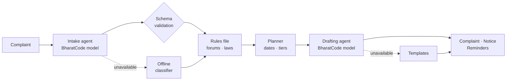

<a href="https://haq-glqi.onrender.com"></a>

<div align="center">

**An AI consumer-rights agent for India, built on the BharatCode model API.**

[](https://haq-glqi.onrender.com)
[](https://github.com/Kavaykhurana/bharatcode/actions/workflows/ci.yml)
[](https://nextjs.org)
[](tsconfig.json)
[](LICENSE)

[**Try it live**](https://haq-glqi.onrender.com) · [How it works](#how-it-works) · [Run locally](#getting-started)

</div>

<br />


## About

A UPI transfer leaves your account and never arrives. A phone is dead on delivery and the return is refused. A flight is cancelled and the refund stalls.

Indian law already protects people in these situations. The RBI owes you **₹100 a day** while a failed transfer stays unreversed. Fraud reported within **three working days** carries **zero liability**. Consumer Commission filing is **free** for claims up to ₹5 lakh. Most people never use these protections because they don't know where to complain, what to write, or when a deadline closes.

**Haq** answers all three. Describe the problem in English, Hindi or Hinglish. Haq identifies the right forum, lays out the escalation path with real dates, cites the rules that apply, and drafts the complaint for you.

## Features

| Capability | What it does |
|---|---|
| **Understands plain language** | Extracts the company, amount, date and every UTR, order ID, PNR or policy number from free text in English, Hindi or Hinglish. |
| **Routes to the right forum** | Builds the escalation ladder the rules require, e.g. bank → RBI Ombudsman → Consumer Commission, with portals and helplines. |
| **Computes every deadline** | Escalation dates, the zero-liability window in working days, compensation already accrued, the two-year limitation, and the Commission tier with jurisdiction. |
| **Cites only real law** | Provisions come from a reviewed rules file, never from the model, so helplines and sections cannot be invented. |
| **Drafts the document** | A complaint to the company, a legal notice, or text for the regulator's portal, streamed live in English or Hindi. |
| **Keeps you on schedule** | One-click calendar reminders (`.ics`) for every escalation date, plus WhatsApp share, copy, download and print-to-PDF. |
| **Never goes dark** | If the model is unavailable, a rule-based classifier and templates take over, so the user still gets a complete plan. |

## Screenshots


<table>
  <tr>
    <td width="64%" valign="top"></td>
    <td width="36%" valign="top"></td>
  </tr>
  <tr>
    <td align="center"><sub>Legal notice for a defective order, from the offline template</sub></td>
    <td align="center"><sub>Cyber-fraud case on mobile, deadline flagged</sub></td>
  </tr>
</table>

## How it works

The model reads and writes. **It never decides where you go.** Forums, deadlines and statutes come from a human-reviewed rules file, and the model's output is validated before anything is shown.



## Coverage

| Problem | First stop | Escalation path | Key provision |
|---|---|---|---|
| Banking, UPI, cards | Bank or UPI app | RBI Ombudsman → Consumer Commission | RBI TAT circular 2019 |
| Cyber fraud | 1930 · cybercrime.gov.in | Bank → RBI Ombudsman → Consumer Commission | RBI liability circular 2017 |
| E-commerce | Platform Grievance Officer | NCH 1915 → Legal notice → e-Daakhil | E-Commerce Rules 2020 |
| Telecom, broadband, DTH | Complaint centre (198) | Appellate Authority → NCH → Consumer Commission | TRAI Regulations 2012 |
| Insurance | Insurer's Grievance Officer | Bima Bharosa → Insurance Ombudsman → Consumer Commission | Ombudsman Rules 2017 |
| Airlines | Airline nodal officer | AirSewa → Consumer Commission | DGCA CAR Sec. 3, Series M |
| Real estate | Builder (written demand) | State RERA → Consumer Commission | RERA 2016, Sec. 18 |
| Other goods and services | Company grievance cell | NCH → Legal notice → e-Daakhil | Consumer Protection Act 2019 |

## Tech stack

| Layer | Technology |
|---|---|
| Framework | Next.js 15 (App Router), React 19, TypeScript (strict) |
| AI | BharatCode model API (OpenAI-compatible), dependency-free client with streaming |
| Validation | zod |
| Styling | Tailwind CSS with custom design tokens; Fraunces, Inter and Noto Devanagari |
| Testing | Vitest, plus a GitHub Actions CI pipeline |
| Hosting | Render (Singapore), defined in [`render.yaml`](render.yaml) |

## Getting started

Requires Node.js 18.18 or later.

```bash
git clone https://github.com/Kavaykhurana/bharatcode.git
cd bharatcode && npm install
cp .env.example .env.local   # add BHARATCODE_API_KEY to enable the AI agents
npm run dev                  # http://localhost:3000
```

Without an API key, Haq runs in offline mode.

## Deployment

Live on Render at **[haq-glqi.onrender.com](https://haq-glqi.onrender.com)**, auto-deployed from `main` via [`render.yaml`](render.yaml).

## Team

Built by **Team AlphaFire** for the **BharatCode Build League 2026**.

| Member | GitHub |
|---|---|
| Kavay Khurana | [@Kavaykhurana](https://github.com/Kavaykhurana) |
| Harshit Atal | [@harshit174](https://github.com/harshit174) |

If you think every consumer should know where to complain, **star the repository**. It helps others find it.

## Disclaimer

Haq provides legal information, not legal advice. Rules and limits are curated from official sources, last reviewed in November 2026, and may change. Verify on the linked government portals before filing.

## License

[MIT](LICENSE) © 2026 Kavay Khurana, Harshit Atal and Team AlphaFire
