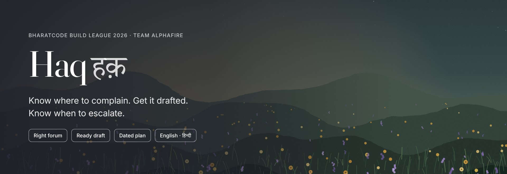
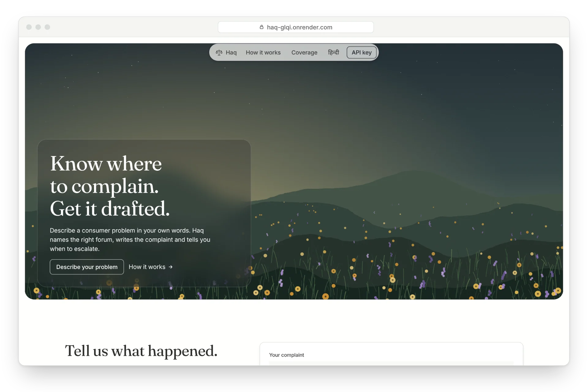
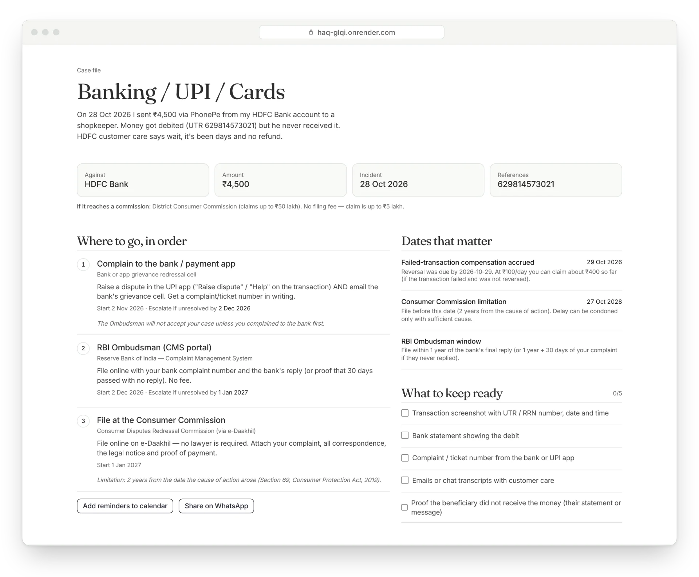
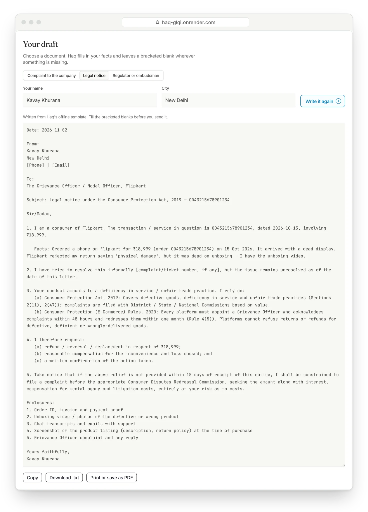
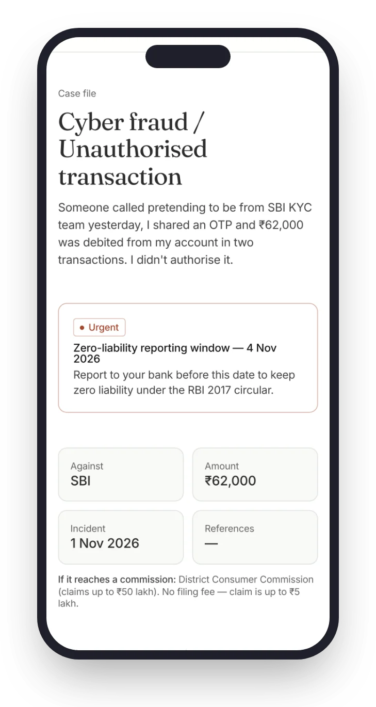
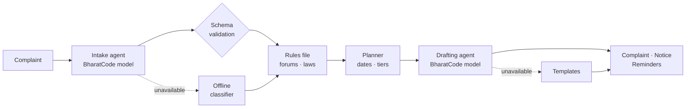

<a href="https://haq-glqi.onrender.com"></a>

<div align="center">

**An AI consumer-rights agent for India, built on the BharatCode model API.**

[](https://haq-glqi.onrender.com)
[](https://github.com/Kavaykhurana/bharatcode/actions/workflows/ci.yml)
[](https://nextjs.org)
[](tsconfig.json)
[](LICENSE)

[**Try it live**](https://haq-glqi.onrender.com) · [How it works](#how-it-works) · [Run locally](#getting-started) · [API](#api-reference)

</div>

<br />



## About

A UPI transfer leaves your account and never arrives. A phone is dead on delivery and the return is refused. A flight is cancelled and the refund stalls.

Indian law already protects people in these situations. The RBI owes you **₹100 a day** while a failed transfer stays unreversed. Fraud reported within **three working days** carries **zero liability**. Consumer Commission filing is **free** for claims up to ₹5 lakh. Most people never use these protections because they don't know where to complain, what to write, or when a deadline closes.

**Haq** answers all three. Describe the problem in English, Hindi or Hinglish. Haq identifies the right forum, lays out the escalation path with real dates, cites the rules that apply, and drafts the complaint for you.

## Features

| Capability | What it does |
|---|---|
| **Understands plain language** | Extracts the company, amount, date and every UTR, order ID, PNR or policy number from free text in English, Hindi or Hinglish. |
| **Routes to the right forum** | Builds the escalation ladder the rules require, e.g. bank → RBI Ombudsman → Consumer Commission, with portals and helplines. |
| **Computes every deadline** | Escalation dates, the zero-liability window in working days, compensation already accrued, the two-year limitation, and the Commission tier with jurisdiction. |
| **Cites only real law** | Provisions come from a reviewed rules file, never from the model, so helplines and sections cannot be invented. |
| **Drafts the document** | A complaint to the company, a legal notice, or text for the regulator's portal, streamed live in English or Hindi. |
| **Keeps you on schedule** | One-click calendar reminders (`.ics`) for every escalation date, plus WhatsApp share, copy, download and print-to-PDF. |
| **Never goes dark** | If the model is unavailable, a rule-based classifier and templates take over, so the user still gets a complete plan. |

## Screenshots



<table>
  <tr>
    <td width="64%" valign="top"></td>
    <td width="36%" valign="top"></td>
  </tr>
  <tr>
    <td align="center"><sub>Legal notice for a defective order, from the offline template</sub></td>
    <td align="center"><sub>Cyber-fraud case on mobile, deadline flagged</sub></td>
  </tr>
</table>

## How it works

The model reads and writes. **It never decides where you go.** Forums, deadlines and statutes come from a human-reviewed rules file, and the model's output is validated before anything is shown.



1. **Intake agent.** The BharatCode model, at temperature 0, turns the complaint into structured JSON.
2. **Validation.** The JSON is parsed defensively and checked against a strict zod schema. An invalid field is repaired individually rather than discarding the whole result.
3. **Rules file.** [`lib/knowledge.ts`](lib/knowledge.ts) is a typed, reviewed record of forums, escalation order, waiting periods, statutes and evidence lists.
4. **Planner.** [`lib/planner.ts`](lib/planner.ts) holds pure, unit-tested functions for every date and jurisdiction calculation.
5. **Drafting agent.** The BharatCode model, streamed, writes the document from the extracted facts. It may cite only the provisions supplied for that category, and it leaves blanks instead of guessing.

## Coverage

| Problem | First stop | Escalation path | Key provision |
|---|---|---|---|
| Banking, UPI, cards | Bank or UPI app | RBI Ombudsman → Consumer Commission | RBI TAT circular 2019 |
| Cyber fraud | 1930 · cybercrime.gov.in | Bank → RBI Ombudsman → Consumer Commission | RBI liability circular 2017 |
| E-commerce | Platform Grievance Officer | NCH 1915 → Legal notice → e-Daakhil | E-Commerce Rules 2020 |
| Telecom, broadband, DTH | Complaint centre (198) | Appellate Authority → NCH → Consumer Commission | TRAI Regulations 2012 |
| Insurance | Insurer's Grievance Officer | Bima Bharosa → Insurance Ombudsman → Consumer Commission | Ombudsman Rules 2017 |
| Airlines | Airline nodal officer | AirSewa → Consumer Commission | DGCA CAR Sec. 3, Series M |
| Real estate | Builder (written demand) | State RERA → Consumer Commission | RERA 2016, Sec. 18 |
| Other goods and services | Company grievance cell | NCH → Legal notice → e-Daakhil | Consumer Protection Act 2019 |

## Tech stack

| Layer | Technology |
|---|---|
| Framework | Next.js 15 (App Router), React 19, TypeScript (strict) |
| AI | BharatCode model API (OpenAI-compatible), dependency-free client with streaming |
| Validation | zod |
| Styling | Tailwind CSS with custom design tokens; Fraunces, Inter and Noto Devanagari |
| Testing | Vitest, plus a GitHub Actions CI pipeline |
| Hosting | Render (Singapore), defined in [`render.yaml`](render.yaml) |

## Getting started

**Prerequisites:** Node.js 18.18 or later.

```bash
git clone https://github.com/Kavaykhurana/bharatcode.git
```

```bash
cd bharatcode && npm install
```

```bash
cp .env.example .env.local
```

```bash
npm run dev
```

Open [http://localhost:3000](http://localhost:3000). Without an API key, Haq runs in offline mode.

### Environment variables

| Variable | Required | Default |
|---|---|---|
| `BHARATCODE_API_KEY` | For AI mode | — |
| `BHARATCODE_BASE_URL` | No | `https://bharatcode.ai/api/model/v1` |
| `BHARATCODE_MODEL` | No | `qwen-3.8-27b` |
| `RATE_LIMIT_PER_MINUTE` | No | `20` |

Visitors can also supply their own key from the **API key** menu in the app. It is stored only in their browser and is never logged on the server.

## Deployment

Production runs on **Render** and redeploys automatically on every push to `main`.

[](https://render.com/deploy?repo=https://github.com/Kavaykhurana/bharatcode)

The Blueprint in [`render.yaml`](render.yaml) configures the build, start command and health check (`/api/health`). Render only asks for `BHARATCODE_API_KEY`.

> On Render's free tier, the first request after a period of inactivity can take up to a minute while the instance wakes.

## API reference

<details>
<summary><code>GET /api/health</code> — liveness probe</summary>

<br />

```json
{ "status": "ok", "mode": "ai", "time": "2026-11-02T15:41:53.000Z" }
```

`mode` is `ai` when a server key is configured and `offline` otherwise. The key itself is never exposed.

</details>

<details>
<summary><code>POST /api/analyze</code> — classify a complaint and build the plan</summary>

<br />

```json
{ "story": "On 28 Oct I sent ₹4,500 via PhonePe…", "language": "en", "today": "2026-11-02" }
```

The response is streamed NDJSON: `step` events as each stage runs, then one `result` event containing the plan (`intake`, `steps`, `deadlines`, `laws`, `evidence`, `commission`, `mode`).

</details>

<details>
<summary><code>POST /api/draft</code> — stream a document</summary>

<br />

```json
{
  "intake": { "category": "ecommerce", "opposite_party": "Flipkart", "amount_inr": 18999 },
  "story": "Ordered a phone on Flipkart…",
  "docType": "legal_notice",
  "language": "en",
  "complainant": { "name": "Kavay Khurana", "city": "New Delhi" }
}
```

`docType` is one of `company_complaint`, `legal_notice` or `regulator_complaint`. The response is streamed plain text, and the `X-Haq-Mode` header reports `ai` or `offline`.

</details>

All routes validate input. They return `400` for invalid input and `429` with `Retry-After` when rate-limited.

## Project structure

<details>
<summary>Expand</summary>

```
app/
├── api/
│   ├── analyze/route.ts   Intake → rules → planner (streamed NDJSON)
│   ├── draft/route.ts     Drafting agent with template fallback (streamed)
│   └── health/route.ts    Liveness probe
├── fonts.ts               Font loading via next/font
├── globals.css            Design tokens and components
└── layout.tsx · page.tsx
components/
└── HaqApp.tsx             Client UI
lib/
├── knowledge.ts           Rules file — forums, ladders, statutes, evidence
├── bharatcode.ts          BharatCode API client (timeouts, retry, SSE)
├── agent.ts               Classification, validation and repair
├── prompts.ts             Agent prompts
├── planner.ts             Dates, working days, limitation, jurisdiction
├── heuristics.ts          Offline classifier and extractors
├── json.ts                Defensive JSON parsing and stream filtering
├── templates.ts           Bilingual document templates
├── ics.ts                 Calendar export
└── ratelimit.ts           Per-IP rate limiting
tests/core.test.ts         Unit tests
render.yaml                Render Blueprint
```

</details>

## Testing

```bash
npm run typecheck && npm test
```

The 23 unit tests cover the planner, routing, extractors for Indian amounts, dates and reference numbers, JSON repair, the streaming filter, calendar export and templates. CI runs the typecheck, tests and a production build on every push.

## Security and privacy

- No database. Complaints are processed per request and never stored.
- No secrets in the repository. Keys live only in environment variables.
- Input limits, schema validation and per-IP rate limiting on every route.
- Strict security headers: `X-Frame-Options`, `X-Content-Type-Options`, `Referrer-Policy` and `Permissions-Policy`.

## Roadmap

- [ ] Voice input in Indian languages
- [ ] Tamil, Telugu, Bengali and Marathi
- [ ] Bill or screenshot upload with automatic reference extraction
- [ ] State-wise RERA portals and electricity ombudsmen
- [ ] Case tracking with reminders

## Team

Built by **Team AlphaFire** for the **BharatCode Build League 2026**.

| Member | GitHub |
|---|---|
| Kavay Khurana | [@Kavaykhurana](https://github.com/Kavaykhurana) |

If you think every consumer should know where to complain, **star the repository**. It helps others find it.

## Disclaimer

Haq provides legal information, not legal advice. Rules and limits are curated from official sources, last reviewed in November 2026, and may change. Verify on the linked government portals before filing.

## License

[MIT](LICENSE) © 2026 Kavay Khurana and Team AlphaFire
