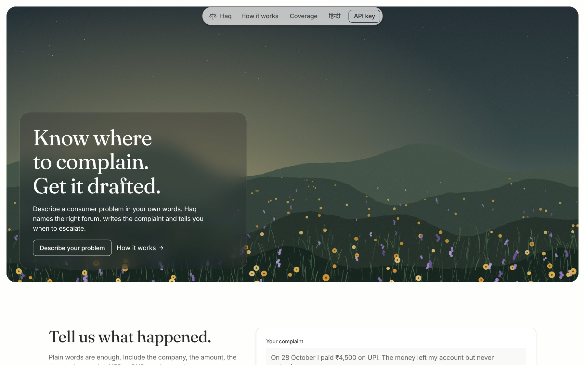
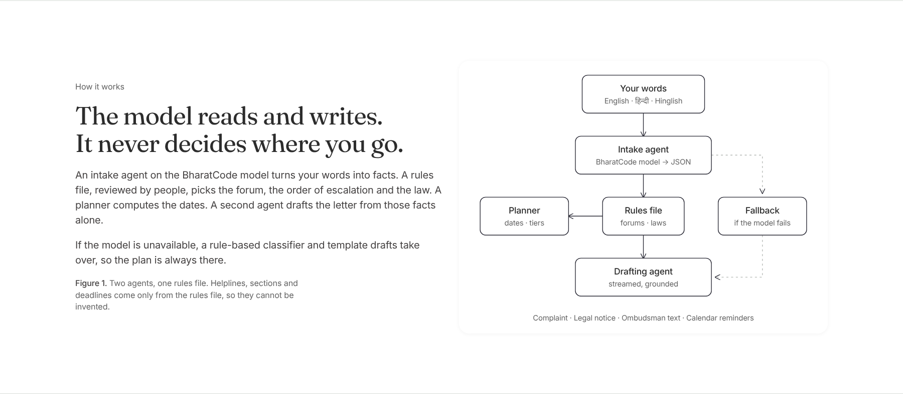
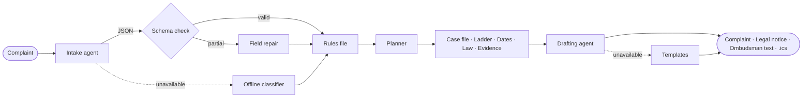
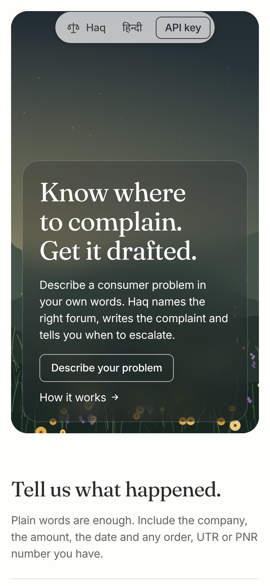

<div align="center">



<h1>Haq · हक़</h1>

<p><strong>A consumer-rights agent for India.</strong><br/>
Describe a problem in your own words. Haq names the right forum, drafts the complaint, and tells you when to escalate.</p>

<p>
<a href="https://github.com/Kavaykhurana/bharatcode/actions/workflows/ci.yml"></a>


<a href="LICENSE"></a>
<a href="https://haq-glqi.onrender.com"></a>
</p>

<p>
<a href="https://haq-glqi.onrender.com"><strong>Open the live app →</strong></a>
</p>

<p>
<a href="#overview">Overview</a> ·
<a href="#how-it-works">How it works</a> ·
<a href="#coverage">Coverage</a> ·
<a href="#getting-started">Getting started</a> ·
<a href="#api-reference">API</a> ·
<a href="#engineering-notes">Engineering notes</a>
</p>

</div>

---

## Overview

Every consumer in India has rights. Few know where to use them.

A UPI transfer leaves your account and never arrives. A phone is dead on delivery and the return is refused. A flight is cancelled and the refund stalls. The protections already exist: the RBI requires a failed transfer to be reversed by the next day and pays **₹100 for every day of delay**. Fraud reported within **three working days** carries **zero liability**. Banks and insurers each have a free ombudsman, and the Consumer Commission charges **no fee** for claims up to ₹5 lakh.

People lose these remedies for three ordinary reasons. They don't know **where** to complain, or in what order. They don't know **what** to write. And they don't know **when** a deadline is about to close. Haq answers all three in under a minute, in English or Hindi.

Haq was built by Team AlphaFire for the **BharatCode Build League 2026**, on the **BharatCode model API**.

**Live:** [haq-glqi.onrender.com](https://haq-glqi.onrender.com). It is hosted on Render's free tier, so the first request after a period of inactivity can take up to a minute while the instance wakes.

## What Haq produces

| Output | Detail |
|---|---|
| **Case file** | The company, amount, incident date and every UTR, order ID, PNR or policy number, extracted from free text in English, Hindi or Hinglish. |
| **Escalation ladder** | The forums for this kind of case, in the order the rules require, with portals and helplines. The RBI Ombudsman, for example, will not hear a case the bank has not seen first. |
| **Dates that matter** | When to escalate at each step, the zero-liability window counted in working days, the compensation already owed, the two-year limitation, and the Consumer Commission tier with jurisdiction. |
| **The law on your side** | Only the provisions that apply, drawn from a reviewed rules file: RBI circulars, the Consumer Protection Act 2019, the E-Commerce Rules 2020, DGCA CARs, RERA and the ombudsman schemes. |
| **A ready draft** | A complaint to the company, a legal notice, or text for the regulator's portal, streamed live. Wherever a fact is unknown, the draft leaves a bracketed blank instead of guessing. |
| **Reminders** | One `.ics` file with every escalation date. Plus WhatsApp share, copy, download and print-to-PDF. |

<table>
<tr>
<td width="56%" valign="top"></td>
<td width="44%" valign="top"></td>
</tr>
<tr>
<td align="center"><sub><b>Figure 1.</b> A failed UPI transfer becomes a three-step ladder with dates and accrued compensation.</sub></td>
<td align="center"><sub><b>Figure 2.</b> A legal notice for a defective order. Unknown facts stay as blanks.</sub></td>
</tr>
</table>

## How it works

> **The model reads and writes. It never decides where you go.**



The work is split between two language-model agents and a set of deterministic components:

1. **Intake agent** (BharatCode model, temperature 0). Turns the complaint into structured JSON: category, opposite party, amount, date, references, missing facts, confidence.
2. **Validation.** The JSON is extracted defensively (it tolerates code fences, `<think>` blocks and trailing commas), then checked against a strict zod schema. If a single field is invalid, only that field is replaced with the output of the offline extractor.
3. **Rules file** ([`lib/knowledge.ts`](lib/knowledge.ts)). A human-reviewed, typed record of forums, escalation order, waiting periods, statutes, helplines and evidence lists for each category. Everything Haq tells a user to *do* comes from here.
4. **Planner** ([`lib/planner.ts`](lib/planner.ts)). Pure functions that compute escalation dates, working-day windows, accrued compensation, limitation and the Commission tier. No date arithmetic is left to the model.
5. **Drafting agent** (BharatCode model, streamed). Writes the chosen document from the extracted facts, citing only the provisions the rules file supplies for that category. `<think>` spans are filtered out of the stream.
6. **Fallback.** If there is no key, the API is unreachable or the output is unusable, a rule-based classifier and bilingual templates take over. The user always gets a complete plan.



## Coverage

| Problem | First stop | Escalation | Key provision |
|---|---|---|---|
| Banking, UPI, cards | Bank or UPI app dispute | RBI Ombudsman (cms.rbi.org.in, 14448) → Consumer Commission | RBI TAT circular 2019: reversal by T+1, then ₹100 per day |
| Cyber fraud | 1930 and cybercrime.gov.in, same day | Bank in writing → RBI Ombudsman → Consumer Commission | RBI circular 2017: zero liability if reported within 3 working days |
| E-commerce | Platform Grievance Officer | National Consumer Helpline (1915) → Legal notice → e-Daakhil | E-Commerce Rules 2020: 48-hour acknowledgement, one-month resolution |
| Telecom, broadband, DTH | Complaint centre (198) | Appellate Authority → NCH → Consumer Commission | TRAI Complaint Redressal Regulations 2012 |
| Insurance | Insurer's Grievance Officer | Bima Bharosa → Insurance Ombudsman → Consumer Commission | Insurance Ombudsman Rules 2017: claims up to ₹50 lakh |
| Airlines | Airline nodal officer | AirSewa → Consumer Commission | DGCA CAR Section 3, Series M, Parts II and IV |
| Real estate | Written demand to the builder | State RERA → Consumer Commission | RERA 2016, Section 18: refund with interest, or interest for delay |
| Other goods and services | Company grievance cell | NCH → Legal notice → e-Daakhil | Consumer Protection Act 2019 |

The Consumer Commission tier follows the 2021 pecuniary limits: District up to ₹50 lakh, State up to ₹2 crore, National above that.

## Getting started

**Requirements:** Node.js 18.18 or later (20 recommended).

```bash
git clone https://github.com/Kavaykhurana/bharatcode.git
```

```bash
cd bharatcode && npm install
```

```bash
cp .env.example .env.local
```

```bash
npm run dev
```

Open `http://localhost:3000`. Without a key Haq runs in **offline mode**, so you can try the whole flow at once. Add `BHARATCODE_API_KEY` to `.env.local` to turn on the agents.

### Configuration

| Variable | Required | Default | Purpose |
|---|---|---|---|
| `BHARATCODE_API_KEY` | For AI mode | — | Server-side key for the BharatCode model API |
| `BHARATCODE_BASE_URL` | No | `https://bharatcode.ai/api/model/v1` | OpenAI-compatible endpoint |
| `BHARATCODE_MODEL` | No | `qwen-3.8-27b` | Model identifier |
| `RATE_LIMIT_PER_MINUTE` | No | `20` | Per-IP limit on each API route |

**Bring your own key.** A visitor can paste their own BharatCode key under *API key* in the navigation. It stays in that browser's `localStorage`, is sent only to Haq's own routes in the `x-bharatcode-key` header, and is never logged or stored on the server.

### Deploy

Haq runs in production on **Render**, defined in [`render.yaml`](render.yaml): a Node web service in the Singapore region, with a health check at `/api/health` and automatic redeploys on every push to `main`.

[](https://render.com/deploy?repo=https://github.com/Kavaykhurana/bharatcode)

To run your own copy:

1. Click **Deploy to Render** above and sign in.
2. Paste your `BHARATCODE_API_KEY` when Render asks for it. Every other setting is already in the Blueprint.
3. Open the `onrender.com` URL Render gives you.

There is no database, no authentication and no other service to configure. `GET /api/health` returns `{"status":"ok","mode":"ai"}` once a key is set, or `"mode":"offline"` without one.

### Scripts

| Command | Purpose |
|---|---|
| `npm run dev` | Development server |
| `npm run build` · `npm start` | Production build and server |
| `npm run typecheck` | `tsc --noEmit` in strict mode |
| `npm test` | 23 Vitest unit tests: planner, routing, extractors, JSON repair, stream filter, iCalendar, templates |

## API reference

### `GET /api/health`

Liveness probe. It returns `status`, and a `mode` of `ai` or `offline` depending on whether the server has a model key. The key itself is never exposed.

### `POST /api/analyze`

Classifies the complaint and returns the plan as a stream of newline-delimited JSON events.

```json
{ "story": "On 28 Oct I sent ₹4,500 via PhonePe…", "language": "en", "today": "2026-11-02" }
```

```jsonl
{"type":"step","id":"classify","status":"running","detail":"Reading your complaint with the BharatCode model"}
{"type":"step","id":"classify","status":"done","detail":"Identified: banking upi"}
{"type":"step","id":"route","status":"done","detail":"3-step escalation ladder · 3 provisions"}
{"type":"result","plan":{"intake":{},"steps":[],"deadlines":[],"laws":[],"commission":{},"mode":"ai"}}
```

### `POST /api/draft`

Streams the document as plain text. The `X-Haq-Mode` header reports `ai` or `offline`.

```json
{
  "intake": { "category": "ecommerce", "opposite_party": "Flipkart", "amount_inr": 18999 },
  "story": "Ordered a phone on Flipkart…",
  "docType": "legal_notice",
  "language": "hi",
  "complainant": { "name": "Kavay Khurana", "city": "New Delhi" }
}
```

`docType` is one of `company_complaint`, `legal_notice` or `regulator_complaint`. Both routes validate input with zod. They return `400` for invalid input, and `429` with `Retry-After` when rate-limited.

## Engineering notes

**Grounding over generation.** The drafting prompt only receives the provisions for the classified category, and it is told to leave blanks rather than invent facts. A helpline number or a section reference can only come from the rules file.

**Validated, never trusted.** Model output is parsed defensively and checked against a schema. Repair happens field by field, so one bad value doesn't throw away an otherwise good extraction.

**Deterministic where it matters.** Dates, working days, compensation and jurisdiction are plain functions with unit tests.

**Always available.** The offline path is a complete product, not an error page. It handles Indian amount formats (lakh, crore, ₹, Rs), relative dates ("yesterday", "kal") and common reference-number shapes.

**Streaming throughout.** Analysis streams agent steps, and drafts stream token by token. The client handles a model that fails mid-stream by swapping in the template cleanly.

### Project structure

```
app/
  api/analyze/route.ts   Intake → rules → planner, streamed as NDJSON
  api/draft/route.ts     Streaming drafting agent with template fallback
  api/health/route.ts    Liveness probe used by Render
  fonts.ts               Fraunces, Inter and Noto Devanagari via next/font
  globals.css            Design tokens and components (literary editorial system)
  layout.tsx, page.tsx   Shell and metadata
components/
  HaqApp.tsx             The client: intake, agent trace, results, drafting, editorial sections
lib/
  knowledge.ts           Rules file: forums, ladders, statutes, evidence — the source of truth
  bharatcode.ts          OpenAI-compatible client: timeouts, retry, SSE parsing
  agent.ts               Classification with schema validation and field-level repair
  prompts.ts             Intake and drafting prompts
  planner.ts             Escalation dates, working days, limitation, Commission tiers
  heuristics.ts          Offline classifier and extractors
  json.ts                Defensive JSON extraction and streaming <think> filter
  templates.ts           Bilingual document templates
  ics.ts                 RFC 5545 calendar export
  ratelimit.ts           Per-IP fixed-window limiter
public/scenes/           Painted stand-in illustrations (SVG)
tests/core.test.ts       Unit tests
render.yaml              Render Blueprint (production deployment)
```

### Design

The interface follows a literary editorial system:
- a warm parchment canvas, with Fraunces for headings and Inter for everything else
- 1px green-grey hairlines instead of heavy shadows
- a single blue, used only as an outline on primary actions
- painted scenes that carry the atmosphere, so the interface itself can stay quiet

Hindi falls back to Noto Serif and Noto Sans Devanagari, so it keeps the same hierarchy. The layout is tested at 1440px and 390px.

<p align="center"></p>

## Security and privacy

- **No storage.** There is no database: each complaint is processed in memory for one request and never persisted.
- **No secrets in the repository.** Server keys live only in environment variables.
- **Request limits.** Every route has input length caps, schema validation and per-IP rate limiting.
- **Strict response headers:** `X-Frame-Options: DENY`, `nosniff`, `Referrer-Policy` and `Permissions-Policy`.
- **Minimal model input.** The model receives only the user's own complaint, never credentials.

## Roadmap

- Voice input in Indian languages, for people who would rather speak than type
- Tamil, Telugu, Bengali and Marathi
- Upload a bill or screenshot to fill reference numbers automatically
- State-wise RERA portals and electricity ombudsmen
- A case tracker with reminders, beyond a calendar file

## Team

**Team AlphaFire**, BharatCode Build League 2026

- Kavay Khurana · [@Kavaykhurana](https://github.com/Kavaykhurana)

If you think every consumer should know where to complain, a star on the repository helps others find it.

## Disclaimer

Haq provides legal information, not legal advice. Forums, limits and timelines are curated from official sources, last reviewed in November 2026, and they can change. Verify on the linked government portals before filing. For complex or high-value disputes, consult an advocate.

## Licence

Released under the [MIT licence](LICENSE).
