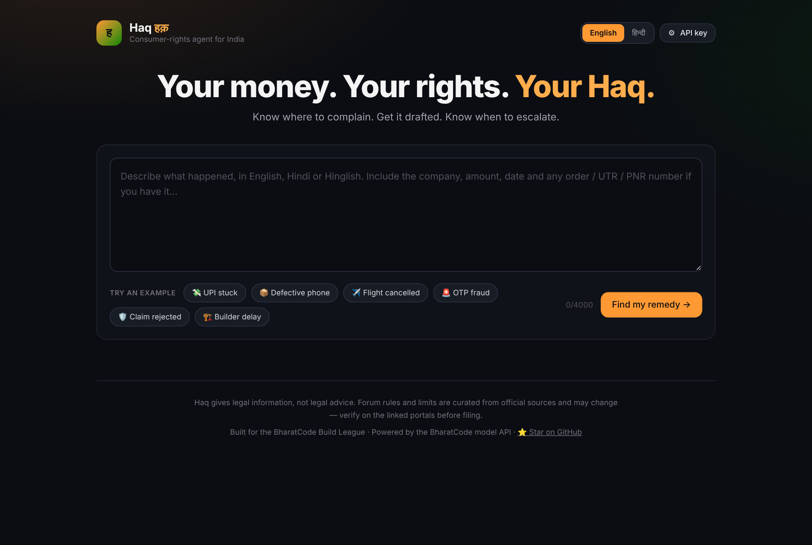
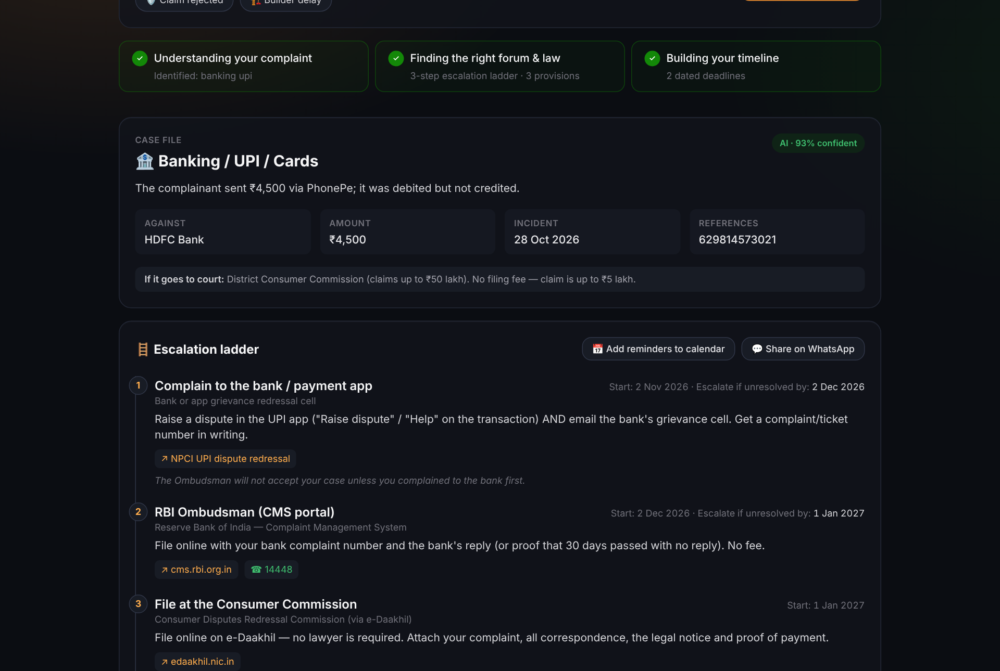
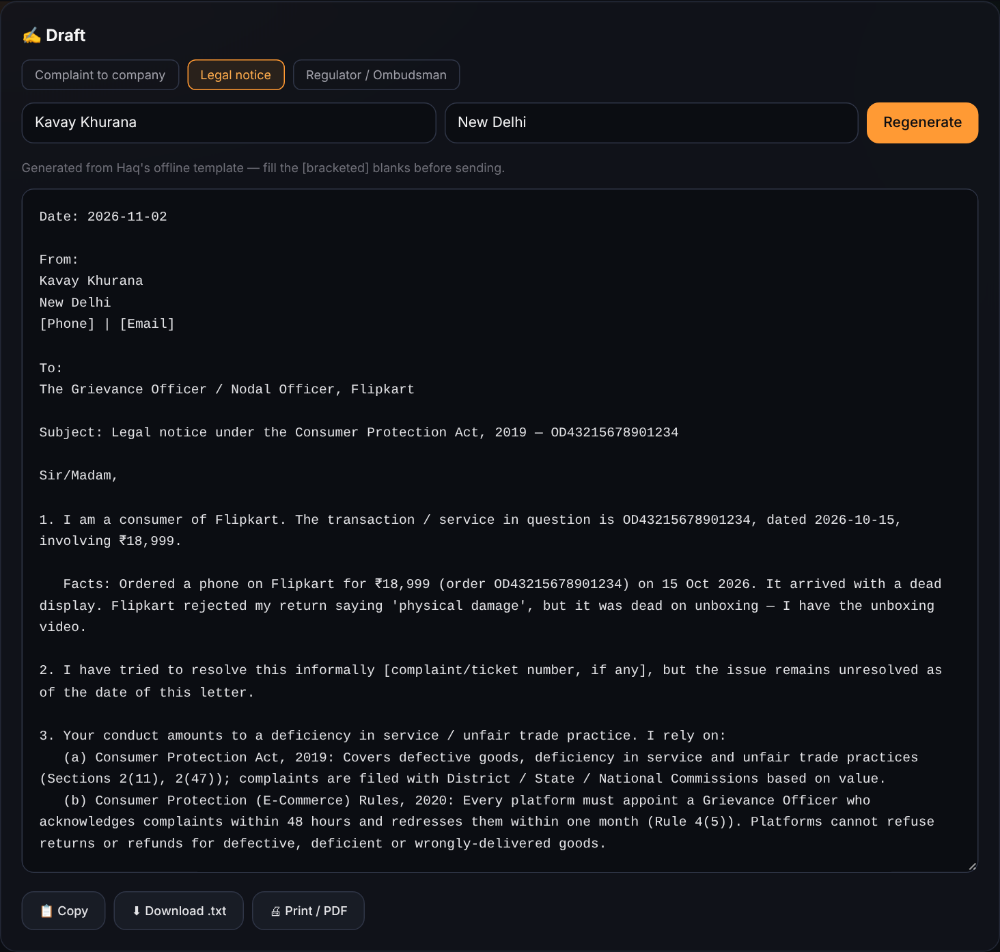
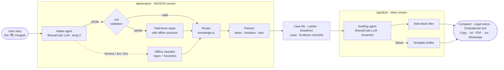

<div align="center">

# Haq · हक़

**An AI consumer-rights agent for India.**
Describe your problem in Hindi or English. Haq tells you *where* to complain, *drafts* the complaint, and tells you *when* to escalate.

[](https://github.com/Kavaykhurana/bharatcode/actions/workflows/ci.yml)


[](LICENSE)

[**Deploy your own**](https://vercel.com/new/clone?repository-url=https%3A%2F%2Fgithub.com%2FKavaykhurana%2Fbharatcode&env=BHARATCODE_API_KEY&envDescription=BharatCode%20model%20API%20key&project-name=haq) · [How it works](#how-it-works) · [Run locally](#run-locally) · [Coverage](#what-haq-covers)



</div>

---

## The problem

Every Indian has a version of this story: ₹4,500 debited on UPI, never credited, and the bank says "wait 5–7 days" for three weeks. A phone arrives dead and the return is rejected. A flight is cancelled and the refund disappears into "processing".

Strong protections already exist — the RBI's **₹100/day** compensation for failed transfers, **zero liability** for fraud reported in 3 working days, free ombudsmen for banks and insurers, a **no-fee** Consumer Commission for claims up to ₹5 lakh. Most people never use them, because they don't know:

1. **Where** to complain — and in what order (the RBI Ombudsman rejects you if you skipped the bank).
2. **What** to write — the law, the facts, the reference numbers, a specific demand.
3. **When** to escalate — before a limitation period or a liability window quietly closes.

Haq does all three in about 30 seconds.

## What it does

| | |
|---|---|
| 🧠 **Understands you** | Free text in English, Hindi or Hinglish. Extracts company, amount, date and every UTR / order ID / PNR / policy number. |
| 🪜 **Routes correctly** | Builds the exact escalation ladder for your case — bank → RBI Ombudsman → Consumer Commission, platform → National Consumer Helpline → legal notice → e-Daakhil, 1930 → bank → RBI, and so on. |
| ⚖️ **Cites the law** | Only real, curated provisions: RBI TAT circular (2019), RBI liability circular (2017), Consumer Protection Act 2019, E-Commerce Rules 2020, DGCA CARs, RERA s.18, Ombudsman rules. |
| ⏳ **Computes deadlines** | Escalation dates, zero-liability window in *working* days, ₹100/day compensation already accrued, 2-year limitation, and which Commission tier (District / State / National) has jurisdiction. |
| ✍️ **Drafts the document** | Complaint to the company, legal notice, or ombudsman text — streamed live, in English or Hindi, with bracketed blanks instead of invented facts. |
| 📅 **Keeps you on track** | One-click `.ics` calendar reminders for every escalation date, WhatsApp share, copy, download, print-to-PDF. |
| 🔌 **Never dead** | No key? Network down? Haq falls back to a deterministic classifier and template drafts — the app still works end to end. |

<table>
<tr>
<td width="55%"></td>
<td width="45%"></td>
</tr>
<tr>
<td align="center"><sub>Case file + dated escalation ladder</sub></td>
<td align="center"><sub>Generated legal notice</sub></td>
</tr>
</table>

## How it works

Haq is a small, two-agent pipeline with a hard rule: **the model reads and writes; it never decides where you go.** Every forum, helpline, timeline and statute comes from a human-reviewed knowledge base, so the agent cannot hallucinate a helpline number or a section that doesn't exist.



**Why this split matters**

- **Grounded generation.** The drafting prompt is given *only* the provisions for the classified category and is instructed to leave `[blanks]` rather than invent facts.
- **Validated, not trusted.** Model output goes through `extractJsonObject` (handles fences, `<think>` preambles, trailing commas) and a strict zod schema. If one field is bad, only that field is replaced by the deterministic extractor.
- **Deterministic where it counts.** Dates, working-day windows, compensation and pecuniary jurisdiction are pure functions with unit tests — not LLM arithmetic.
- **Streaming UX.** Analysis streams agent steps as NDJSON; drafts stream token by token so users see progress immediately.

## What Haq covers

| Category | Escalation ladder | Key provisions |
|---|---|---|
| 🏦 Banking / UPI / Cards | Bank & UPI app → **RBI Ombudsman** (cms.rbi.org.in, 14448) → Consumer Commission | RBI TAT circular 2019 (T+1, ₹100/day), Integrated Ombudsman Scheme 2021 |
| 🚨 Cyber fraud | **1930** + cybercrime.gov.in → Bank → RBI Ombudsman → Commission | RBI liability circular 2017 (zero liability in 3 working days), IT Act 66C/66D |
| 📦 E-commerce | Grievance Officer → **NCH 1915** → Legal notice → **e-Daakhil** | CPA 2019, E-Commerce Rules 2020 (48h ack, 1-month resolution) |
| 📶 Telecom / Broadband / DTH | Complaint centre (198) → Appellate Authority → NCH → Commission | TRAI Complaint Redressal Regulations 2012 |
| 🛡️ Insurance | Insurer GRO → **Bima Bharosa** → **Insurance Ombudsman** → Commission | Ombudsman Rules 2017 (up to ₹50 lakh), IRDAI 14-day resolution |
| ✈️ Airline | Airline nodal officer → **AirSewa** → Commission | DGCA CAR M-IV (₹5k/7.5k/10k cancellation; denied-boarding caps), CAR M-II refunds |
| 🏗️ Real estate | Builder demand → **State RERA** → Commission | RERA s.18 (refund + interest), s.31 |
| 🧾 Other goods & services | Company → NCH → Legal notice → e-Daakhil | Consumer Protection Act 2019 |

The knowledge base lives in [`lib/knowledge.ts`](lib/knowledge.ts) — one typed file, easy to review and extend.

## Run locally

**Requirements:** Node.js 18.18+ (20 recommended).

```bash
git clone https://github.com/Kavaykhurana/bharatcode.git
cd bharatcode
npm install
cp .env.example .env.local   # add your BharatCode API key
npm run dev                  # http://localhost:3000
```

Haq runs without a key in **offline mode** (rule-based classifier + template drafts), so you can explore the full flow immediately.

### Configuration

| Variable | Required | Default | Purpose |
|---|---|---|---|
| `BHARATCODE_API_KEY` | For AI mode | — | Server-side key for the BharatCode model API |
| `BHARATCODE_BASE_URL` | No | `https://bharatcode.ai/api/model/v1` | OpenAI-compatible endpoint |
| `BHARATCODE_MODEL` | No | `qwen-3.8-27b` | Model ID |
| `RATE_LIMIT_PER_MINUTE` | No | `20` | Per-IP limit on each API route |

**Bring your own key:** users can paste their own BharatCode key in the ⚙︎ settings panel. It is kept in that browser's `localStorage`, sent only in the `x-bharatcode-key` header to Haq's own API routes, and never logged or stored server-side.

### Scripts

| Command | What it does |
|---|---|
| `npm run dev` | Start the dev server |
| `npm run build` / `npm start` | Production build / serve |
| `npm run typecheck` | `tsc --noEmit` in strict mode |
| `npm test` | Vitest unit tests (planner, router, extractors, JSON repair, stream filter, iCal, templates) |

## Deploy

One click on Vercel: [**Deploy**](https://vercel.com/new/clone?repository-url=https%3A%2F%2Fgithub.com%2FKavaykhurana%2Fbharatcode&env=BHARATCODE_API_KEY&envDescription=BharatCode%20model%20API%20key&project-name=haq). Set `BHARATCODE_API_KEY` when prompted. Nothing else is needed: no database, no auth, no external services.

## API

### `POST /api/analyze`

```jsonc
// request
{ "story": "On 28 Oct I sent ₹4,500 via PhonePe…", "language": "en", "today": "2026-11-02" }
```

The response is `application/x-ndjson`, one event per line:

```jsonc
{"type":"step","id":"classify","status":"running","detail":"Reading your complaint with the BharatCode model"}
{"type":"step","id":"classify","status":"done","detail":"Identified: banking upi"}
{"type":"step","id":"route","status":"done","detail":"3-step escalation ladder · 3 provisions"}
{"type":"result","plan":{ "intake": {…}, "steps": [ … ], "deadlines": [ … ], "laws": [ … ], "commission": {…}, "mode": "ai" }}
```

### `POST /api/draft`

```jsonc
{ "intake": { /* plan.intake */ }, "story": "…", "docType": "legal_notice", "language": "hi",
  "complainant": { "name": "Kavay Khurana", "city": "New Delhi" } }
```

The response is `text/plain`, streamed. The `X-Haq-Mode: ai | offline` header says which path produced it.

Both routes validate input with zod, return `400` on invalid input and `429` with `Retry-After` when rate-limited.

## Project structure

```
app/
  api/analyze/route.ts   Intake → route → plan, streamed as NDJSON
  api/draft/route.ts     Streaming drafting agent with template fallback
  layout.tsx, page.tsx   Shell and metadata
components/
  HaqApp.tsx             Entire client UI (EN/हिं, agent trace, results, drafting)
lib/
  knowledge.ts           Curated forums, ladders, laws, evidence lists — the source of truth
  bharatcode.ts          OpenAI-compatible client: timeouts, retry, SSE parsing
  agent.ts               Classification with schema validation and field-level repair
  prompts.ts             Intake and drafting prompts
  planner.ts             Escalation dates, working days, limitation, commission tiers
  heuristics.ts          Offline classifier: amounts (lakh/crore), dates, UTR/PNR/order IDs
  json.ts                Robust JSON extraction + streaming <think> filter
  templates.ts           Deterministic EN/हिं drafts
  ics.ts                 RFC 5545 calendar export
  ratelimit.ts           Per-IP fixed-window limiter
tests/core.test.ts       23 unit tests
```

## Security & privacy

- No database. Complaints are processed in memory per request and never persisted.
- No secrets in the repo; the server key lives only in environment variables.
- Input length caps, schema validation, per-IP rate limiting and strict security headers (`X-Frame-Options`, `nosniff`, `Referrer-Policy`, `Permissions-Policy`).
- The model never receives the API key or anything beyond the user's own complaint.

## Roadmap

- Voice input in Indian languages (speech → intake) for users who don't type
- More languages: Tamil, Telugu, Bengali, Marathi
- Upload a bill or screenshot → OCR → auto-filled reference IDs
- State-specific RERA portals and electricity ombudsmen
- Case tracker with reminders, not just a calendar file

## Team AlphaFire

Built for the **BharatCode Build League 2026** by Team AlphaFire.

- **Kavay Khurana** — [@Kavaykhurana](https://github.com/Kavaykhurana)

If Haq helped you, or you think it should exist, **⭐ star the repo** — it helps more people find it.

## Disclaimer

Haq provides **legal information, not legal advice**. Forum rules, limits and timelines are curated from official sources (last reviewed November 2026) and can change. Verify on the linked government portals before filing. For complex or high-value disputes, consult an advocate.

## License

[MIT](LICENSE)
